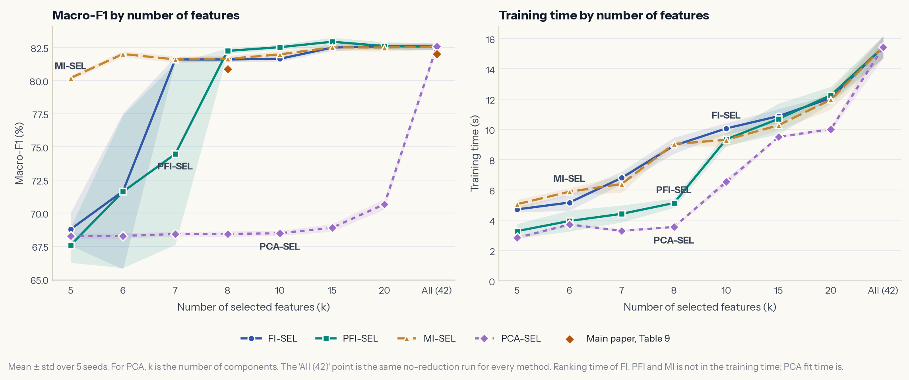
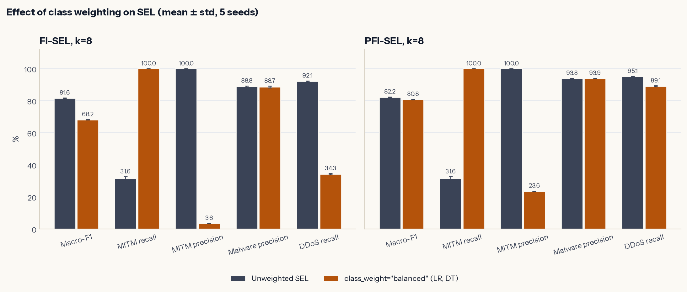

# نتایج {#sec:results}

این فصل نتایج بازپیاده‌سازی را گزارش می‌کند. همه‌ی معیارها درصد هستند. اگر seed ذکر نشده باشد، عدد میانگین ± انحراف معیار روی پنج seed است. SEL در همه‌ی این فصل نسخه‌ی بدون نشت با `stack_method="predict"` است. تفسیر نتایج در @sec:critique می‌آید.

## مقایسه با مقاله‌ی اصلی {#sec:res-paper}

@tbl:res-paper نتیجه‌ی FI-SEL را کنار جدول ۹ مقاله نشان می‌دهد. فاصله‌ی همه‌ی معیارهای کیفیت با مقاله کمتر از یک واحد درصد است. macro-F1 با همه‌ی ویژگی‌ها ۸۲٫۵۷ ± ۰٫۲۴ و با هشت ویژگی ۸۱٫۵۹ ± ۰٫۱۹ است و مقاله ۸۲٫۰۰ و ۸۰٫۸۸ گزارش کرده است. زمان‌های مطلق روی سخت‌افزار دیگری اندازه گرفته شده‌اند و مستقیم قابل مقایسه نیستند. نسبت F1 حالت k=8 به همه‌ی ویژگی‌ها در هر دو کار ۰٫۹۹ است. نسبت زمان آموزش برای ما ۰٫۵۸ و برای مقاله ۰٫۴۳ است و نسبت زمان آزمون ۰٫۵۴ در برابر ۰٫۳۶ است. نسبت حجم pipeline ۱٫۰۰ است، یعنی کاهش ویژگی‌ها حجم را کم نکرده است.

| معیار | مقاله، همه | ما، همه | مقاله، k=8 | ما، k=8 |
|---|---|---|---|---|
| Accuracy | ۸۹٫۰۵ | ۸۹٫۲۵ ± ۰٫۰۷ | ۸۷٫۳۷ | ۸۷٫۷۲ ± ۰٫۱۱ |
| Precision (macro) | ۹۰٫۹۴ | ۹۱٫۱۲ ± ۰٫۰۷ | ۹۰٫۶۵ | ۹۰٫۹۰ ± ۰٫۰۸ |
| Recall (macro) | ۷۹٫۵۳ | ۷۹٫۹۸ ± ۰٫۲۳ | ۷۷٫۷۳ | ۷۸٫۳۸ ± ۰٫۱۴ |
| F1 (macro) | ۸۲٫۰۰ | ۸۲٫۵۷ ± ۰٫۲۴ | ۸۰٫۸۸ | ۸۱٫۵۹ ± ۰٫۱۹ |
| زمان آموزش (s) | ۳۷٫۲۳ | ۱۵٫۴۳ ± ۰٫۷۳ | ۱۶٫۱۸ | ۸٫۹۳ ± ۰٫۵۳ |
| زمان آزمون (s) | ۰٫۲۸ | ۰٫۰۱۳ ± ۰٫۰۰۱ | ۰٫۱۰ | ۰٫۰۰۷ ± ۰٫۰۰۱ |
| نسبت F1 حالت k=8 به همه | – | – | ۰٫۹۹ | ۰٫۹۹ |
| نسبت زمان آموزش | – | – | ۰٫۴۳ | ۰٫۵۸ |
| نسبت حجم pipeline | – | – | – | ۱٫۰۰ |

: مقایسه‌ی FI-SEL بدون نشت با جدول ۹ مقاله‌ی اصلی [@abdulkareem2024, ص. ۹]. عددهای ما میانگین ± انحراف معیار پنج seed هستند {#tbl:res-paper}

## رتبه‌بندی ویژگی‌ها {#sec:res-ranking}

هشت ویژگی برتر FI ما دقیقاً همان هشت ویژگی مقاله هستند. این مجموعه در هر پنج seed ثابت می‌ماند و فقط ترتیب درونی آن تغییر می‌کند. هشت ویژگی برتر PFI هم در هر پنج seed یکسان است و پنج ویژگی از هشت ویژگی FI را دارد. این روش `icmp.seq_le`، `tcp.connection.rst` و `udp.stream` را به‌جای `tcp.ack_raw`، `tcp.flags.ack` و `tcp.checksum` بالا می‌آورد. فقط ۳۳ ویژگی PFI مثبت دارند. MI هم همان هشت ویژگی مقاله را برمی‌گزیند. هزینه‌ی رتبه‌بندی سه روش خیلی متفاوت است. میانگین زمان رتبه‌بندی FI ۰٫۷۴ ثانیه، MI ۲٫۲۴ ثانیه و PFI ۱۱۷٫۵۰ ثانیه است.

## اثر تعداد ویژگی‌ها {#sec:res-ksweep}

@tbl:res-ksweep macro-F1 چهار روش را برای همه‌ی مقدارهای k نشان می‌دهد و @fig:methods-vs-k همین نتیجه را رسم کرده است. عدد بیرون پرانتز نتیجه‌ی seed=42 و عدد داخل پرانتز میانگین پنج seed است. FI و PFI در k=6 و k=7 واریانس زیادی دارند. علت این است که ترتیب درونی هشت ویژگی برتر با seed تغییر می‌کند. برای مثال PFI-SEL با seed=42 در k=6 به ۸۱٫۹۲ می‌رسد، ولی میانگین پنج seed ۷۱٫۶۲ ± ۵٫۷۶ است.

| k | FI-SEL | PFI-SEL | MI-SEL | PCA-SEL |
|---|---|---|---|---|
| ۵ | ۶۹٫۵۵ (۶۸٫۷۸ ± ۱٫۲۴) | ۶۹٫۰۷ (۶۷٫۵۸ ± ۱٫۳۳) | ۸۰٫۲۴ (۸۰٫۲۰ ± ۰٫۱۹) | ۶۸٫۳۴ (۶۸٫۲۶ ± ۰٫۲۱) |
| ۶ | ۶۸٫۹۶ (۷۱٫۶۵ ± ۵٫۸۸) | ۸۱٫۹۲ (۷۱٫۶۲ ± ۵٫۷۶) | ۸۲٫۱۸ (۸۲٫۰۱ ± ۰٫۲۳) | ۶۸٫۵۳ (۶۸٫۲۷ ± ۰٫۲۰) |
| ۷ | ۸۱٫۶۲ (۸۱٫۶۰ ± ۰٫۲۱) | ۸۱٫۹۳ (۷۴٫۴۶ ± ۶٫۸۶) | ۸۱٫۵۹ (۸۱٫۶۰ ± ۰٫۲۳) | ۶۸٫۶۷ (۶۸٫۴۲ ± ۰٫۱۷) |
| ۸ | ۸۱٫۵۸ (۸۱٫۵۹ ± ۰٫۱۹) | ۸۲٫۲۶ (۸۲٫۲۵ ± ۰٫۱۹) | ۸۱٫۷۲ (۸۱٫۶۴ ± ۰٫۲۳) | ۶۸٫۶۷ (۶۸٫۴۲ ± ۰٫۲۱) |
| ۱۰ | ۸۱٫۶۲ (۸۱٫۶۴ ± ۰٫۲۰) | ۸۲٫۶۰ (۸۲٫۵۲ ± ۰٫۱۹) | ۸۲٫۰۹ (۸۱٫۹۸ ± ۰٫۲۴) | ۶۸٫۴۳ (۶۸٫۴۸ ± ۰٫۱۸) |
| ۱۵ | ۸۲٫۶۰ (۸۲٫۴۹ ± ۰٫۲۴) | ۸۳٫۲۳ (۸۲٫۹۳ ± ۰٫۳۱) | ۸۲٫۶۰ (۸۲٫۵۱ ± ۰٫۲۶) | ۶۸٫۹۸ (۶۸٫۸۹ ± ۰٫۲۸) |
| ۲۰ | ۸۲٫۷۷ (۸۲٫۶۰ ± ۰٫۲۲) | ۸۲٫۷۹ (۸۲٫۶۱ ± ۰٫۲۹) | ۸۲٫۷۱ (۸۲٫۵۰ ± ۰٫۲۹) | ۷۰٫۴۵ (۷۰٫۶۷ ± ۰٫۴۰) |
| همه (۴۲) | ۸۲٫۷۳ (۸۲٫۵۷ ± ۰٫۲۴) | ۸۲٫۷۳ (۸۲٫۵۷ ± ۰٫۲۴) | ۸۲٫۷۳ (۸۲٫۵۷ ± ۰٫۲۴) | ۸۲٫۷۳ (۸۲٫۵۷ ± ۰٫۲۴) |

: macro-F1 چهار روش کاهش ابعاد با SEL. عدد بیرون پرانتز seed=42 و عدد داخل پرانتز میانگین ± انحراف معیار پنج seed است {#tbl:res-ksweep}

از k=8 به بعد FI، PFI و MI تقریباً هم‌اندازه هستند. PFI-SEL با k=8 به ۸۲٫۲۵ ± ۰٫۱۹ می‌رسد و FI-SEL به ۸۱٫۵۹ ± ۰٫۱۹. MI-SEL به‌عنوان مقایسه‌ی جانبی اجرا شد و در kهای کوچک پایدارتر از دو روش دیگر است. این روش با k=5 به ۸۰٫۲۰ ± ۰٫۱۹ می‌رسد، در حالی که FI-SEL در همین حالت ۶۸٫۷۸ ± ۱٫۲۴ است.

PCA-SEL در همه‌ی kها ضعیف‌تر از سه روش دیگر است. macro-F1 آن با k=8 برابر ۶۸٫۴۲ ± ۰٫۲۱ و با k=20 برابر ۷۰٫۶۷ ± ۰٫۴۰ است. این افت از واریانس دورریخته نمی‌آید، چون مؤلفه‌ها با k=8 حدود ۸۵٫۲۴ درصد و با k=20 حدود ۹۹٫۸۱ درصد واریانس را نگه می‌دارند. یک توضیح احتمالی این است که DT روی محورهای چرخیده‌ی PCA مرزهای ساده‌ی ویژگی‌های پرچمی و پورت را از دست می‌دهد. این توضیح آزموده نشده است. این نتیجه هم فقط برای PCA بعد از MinMax معتبر است. مقاله‌ی پشتیبان پیش از PCA تبدیل log و استانداردسازی را به کار برده است [@garciamerino2026, ص. ۱۰].

{#fig:methods-vs-k}

## زمان آموزش و حجم pipeline {#sec:res-cost}

@tbl:res-cost زمان آموزش و حجم pipeline را برای FI، PFI و PCA نشان می‌دهد. زمان آموزش با کاهش k کم می‌شود. PFI-SEL با k=8 در ۵٫۱۳ ثانیه آموزش می‌بیند و FI-SEL در ۸٫۹۳ ثانیه. حجم pipeline رفتار دیگری دارد. حجم FI-SEL با k=8 برابر ۲٫۱۹ مگابایت است که با حجم حالت همه‌ی ویژگی‌ها یکی است. با k=5 این حجم به ۳٫۳۹ مگابایت می‌رسد. علت این است که بیشتر حجم را درخت مدل نهایی تعیین می‌کند و تعداد ستون ورودی اثر کمی بر آن دارد. PFI-SEL با k=8 حجم ۱٫۵۴ مگابایت دارد. حجم PCA-SEL در همه‌ی kها بیشتر از حالت همه‌ی ویژگی‌هاست.

| k | زمان FI (s) | زمان PFI (s) | زمان PCA (s) | حجم FI (MB) | حجم PFI (MB) | حجم PCA (MB) |
|---|---|---|---|---|---|---|
| ۵ | ۴٫۷۱ | ۳٫۲۸ | ۲٫۸۴ | ۳٫۳۹ | ۲٫۹۸ | ۵٫۴۰ |
| ۸ | ۸٫۹۳ | ۵٫۱۳ | ۳٫۵۵ | ۲٫۱۹ | ۱٫۵۴ | ۵٫۲۱ |
| همه (۴۲) | ۱۵٫۴۳ | ۱۵٫۴۳ | ۱۵٫۴۳ | ۲٫۱۹ | ۲٫۱۹ | ۲٫۱۹ |

: میانگین زمان آموزش و حجم pipeline در پنج seed. زمان رتبه‌بندی جزو زمان آموزش نیست، ولی زمان fit شدن PCA جزو آن است {#tbl:res-cost}

## نتایج هر کلاس {#sec:res-perclass}

@tbl:res-perclass recall و F1 هر کلاس را کنار جدول ۶ مقاله نشان می‌دهد. در پنج کلاس فاصله‌ی ما با مقاله حدود یک واحد درصد یا کمتر است. کلاس MITM در هر دو کار ضعیف‌ترین کلاس است. recall آن در مقاله ۲۹٫۲۲ و در کار ما ۳۱٫۶۰ است و precision آن در هر دو ۱۰۰ است. recall کلاس MITM در همه‌ی حالت‌های این جدول یکسان است. علت این رفتار در @sec:crit-dup توضیح داده می‌شود. با هشت ویژگی FI، F1 کلاس DDoS از ۹۱٫۸۵ به ۸۷٫۵۱ می‌افتد، ولی PFI این افت را ندارد.

| کلاس | مقاله، همه | ما، همه | ما، FI k=8 | ما، PFI k=8 |
|---|---|---|---|---|
| Normal | ۹۴٫۲۲ / ۹۴٫۴۵ | ۹۴٫۱۳ / ۹۴٫۴۱ | ۹۳٫۸۸ / ۹۴٫۳۱ | ۹۳٫۸۵ / ۹۴٫۴۱ |
| DDoS | ۹۱٫۶۰ / ۹۱٫۵۳ | ۹۲٫۰۳ / ۹۱٫۸۵ | ۹۲٫۰۹ / ۸۷٫۵۱ | ۹۵٫۱۱ / ۹۱٫۹۱ |
| Information gathering | ۹۱٫۷۳ / ۹۱٫۴۱ | ۹۰٫۶۹ / ۹۰٫۹۹ | ۸۵٫۰۴ / ۸۸٫۹۸ | ۹۲٫۸۴ / ۸۷٫۸۵ |
| MITM | ۲۹٫۲۲ / ۴۵٫۲۲ | ۳۱٫۶۰ / ۴۸٫۰۲ | ۳۱٫۶۰ / ۴۸٫۰۲ | ۳۱٫۶۰ / ۴۸٫۰۲ |
| Injection | ۸۳٫۲۰ / ۸۳٫۷۸ | ۸۳٫۲۵ / ۸۴٫۳۰ | ۸۳٫۰۵ / ۸۴٫۱۰ | ۸۴٫۱۰ / ۸۴٫۵۷ |
| Malware | ۸۷٫۱۳ / ۸۵٫۶۰ | ۸۸٫۱۹ / ۸۵٫۸۷ | ۸۴٫۵۹ / ۸۶٫۶۴ | ۸۰٫۶۰ / ۸۶٫۷۲ |

: recall و F1 هر کلاس به شکل «recall / F1». ستون مقاله از جدول ۶ مقاله‌ی اصلی است [@abdulkareem2024, ص. ۷] و ستون‌های ما میانگین پنج seed هستند {#tbl:res-perclass}

## اثر وزن‌دهی کلاس و SMOTE {#sec:res-weight}

@tbl:res-weight و @fig:class-weight اثر `class_weight="balanced"` و SMOTE را با k=8 نشان می‌دهند. حالت بدون وزن یک اجرای دوباره‌ی SEL است که پیش‌بینی بردار تمام‌صفر را هم ثبت می‌کند. این بردار در @sec:crit-dup تعریف می‌شود. هر دو روش در هر پنج seed این بردار را MITM پیش‌بینی می‌کنند. در نتیجه recall کلاس MITM به ۱۰۰ می‌رسد، ولی precision آن برای FI به ۳٫۵۸ و برای PFI به ۲۳٫۶۱ می‌افتد. recall کلاس DDoS در FI-SEL با وزن‌دهی از ۹۲٫۰۹ به ۳۴٫۳۰ می‌افتد. macro-F1 برای FI از ۸۱٫۵۹ به ۶۸٫۱۸ و برای PFI از ۸۲٫۲۵ به ۸۰٫۸۱ کم می‌شود. SMOTE نتیجه‌ی مشابهی دارد.

| حالت | macro-F1 | Recall MITM | Precision MITM | Recall DDoS | پیش‌بینی بردار تمام‌صفر |
|---|---|---|---|---|---|
| FI-SEL، بدون وزن | ۸۱٫۵۹ ± ۰٫۱۹ | ۳۱٫۶۰ | ۱۰۰٫۰۰ | ۹۲٫۰۹ | DDoS |
| FI-SEL، balanced | ۶۸٫۱۸ ± ۰٫۱۳ | ۱۰۰٫۰۰ | ۳٫۵۸ | ۳۴٫۳۰ | MITM |
| FI-SEL، SMOTE | ۶۷٫۵۱ ± ۰٫۰۶ | ۱۰۰٫۰۰ | ۳٫۵۸ | ۳۳٫۱۲ | MITM |
| PFI-SEL، بدون وزن | ۸۲٫۲۵ ± ۰٫۱۹ | ۳۱٫۶۰ | ۱۰۰٫۰۰ | ۹۵٫۱۱ | Information gathering |
| PFI-SEL، balanced | ۸۰٫۸۱ ± ۰٫۱۳ | ۱۰۰٫۰۰ | ۲۳٫۶۱ | ۸۹٫۱۰ | MITM |
| PFI-SEL، SMOTE | ۸۰٫۵۳ ± ۰٫۱۸ | ۱۰۰٫۰۰ | ۲۳٫۶۱ | ۸۸٫۷۷ | MITM |

: اثر وزن‌دهی کلاس و SMOTE بر SEL با k=8. عددها میانگین پنج seed هستند و ستون آخر پیش‌بینی هر پنج seed برای بردار تمام‌صفر است {#tbl:res-weight}

{#fig:class-weight}
