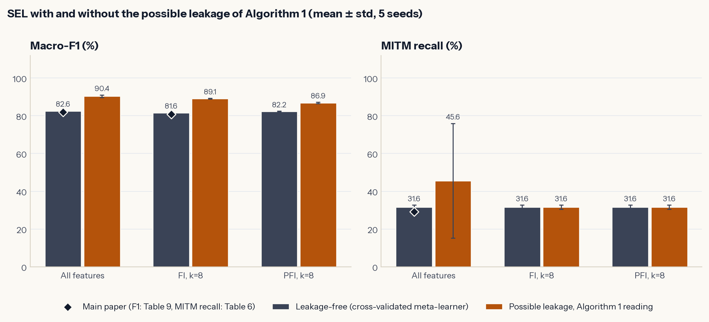

# نقد مقاله‌ی اصلی {#sec:critique}

این فصل هشت نقد را به مقاله‌ی اصلی وارد می‌کند. شش نقد اول از خواندن مقاله آمده‌اند و دو نقد آخر از نتیجه‌ی بازپیاده‌سازی. هر نقد با شاهد از متن مقاله و هرجا ممکن بود با عدد آزمایش ما پشتیبانی می‌شود.

## نقد ۱: کاهش ۸۶٫۹ درصدی حجم اندازه‌گیری نشده است {#sec:crit-size}

چکیده‌ی مقاله می‌گوید FI فضای ذخیره‌سازی داده را ۸۶٫۹ درصد کم می‌کند [@abdulkareem2024, ص. ۱]. جدول ۱۲ مقاله نشان می‌دهد این عدد از نسبت تعداد ویژگی‌ها آمده است. طبق محاسبه‌ی ما، این عدد با کاهش ۶۱ ویژگی خام به ۸ ویژگی می‌خواند [@abdulkareem2024, ص. ۱۱]. مبنای همه‌ی آزمایش‌های خود مقاله ۴۲ ویژگی است و با این مبنا کاهش حدود ۸۱ درصد می‌شود [@abdulkareem2024, ص. ۳ و ۶]. مقاله حجم داده یا مدل را بر حسب بایت گزارش نکرده است. مقاله‌ی پشتیبان حجم واقعی مدل را اندازه گرفته است و در آنجا کاهش ۶۷ درصدی تعداد ویژگی‌ها فقط حدود ۴۵ درصد حجم مدل را کم کرده است [@garciamerino2026, ص. ۱۳].

اندازه‌گیری ما این نقد را تأیید می‌کند. حجم pipeline در FI-SEL با هشت ویژگی ۲٫۱۹ مگابایت است که با حجم حالت همه‌ی ویژگی‌ها یکی است (@tbl:res-cost). PFI-SEL با هشت ویژگی به حجم ۱٫۵۴ مگابایت می‌رسد، که طبق محاسبه‌ی ما حدود ۳۰ درصد کمتر از حالت همه‌ی ویژگی‌هاست. پس کاهش ویژگی‌ها حجم را به نسبت تعداد ویژگی‌ها کم نمی‌کند و ادعای حافظه‌ی مقاله باید با اندازه‌گیری مستقیم سنجیده شود.

## نقد ۲: احتمال نشت داده در الگوریتم ۱ {#sec:crit-leak}

طبق الگوریتم ۱، احتمال نشت وجود دارد [@abdulkareem2024, ص. ۵]. در این الگوریتم مدل‌های پایه روی داده‌ی آزمون پیش‌بینی می‌کنند، مدل نهایی روی دیتاست گروهی ساخته‌شده از همین پیش‌بینی‌ها آموزش می‌بیند و سپس روی همان داده‌ی آزمون ارزیابی می‌شود. با این حال، متن ص. ۴ می‌گوید پیش‌بینی‌ها به داده‌ی آموزش اضافه می‌شوند و نماد F در الگوریتم تعریف نشده است [@abdulkareem2024, ص. ۴]. پس نشت در مقاله قطعی نیست. ریشه‌ی درخت شکل ۶ و ۷ مقاله هم ۶۵٬۵۰۴ نمونه دارد که نه با داده‌ی آموزش می‌خواند و نه با داده‌ی آزمون [@abdulkareem2024, ص. ۱۰]. یعنی متن مقاله برای تشخیص داده‌ی آموزش مدل نهایی کافی نیست.

@tbl:crit-leak و @fig:leaky-vs-clean دو برداشت را مقایسه می‌کنند. نسخه‌ی دارای نشت به macro-F1 برابر ۹۰٫۴۰ ± ۰٫۶۵ و accuracy برابر ۹۸٫۳۵ ± ۰٫۰۴ می‌رسد. این عددها حدود هشت واحد در F1 و نه واحد در accuracy بالاتر از جدول ۹ مقاله هستند، در حالی که نسخه‌ی بدون نشت ما با فاصله‌ی کمتر از یک واحد با آن می‌خواند. پس برداشت لفظی الگوریتم ۱ اعداد مقاله را نمی‌سازد. recall کلاس MITM در نسخه‌ی دارای نشت با همه‌ی ویژگی‌ها ۴۵٫۶۰ ± ۳۰٫۴۲ است. این واریانس زیاد از این می‌آید که مدل نهایی در یک seed بردار تمام‌صفر را MITM پیش‌بینی کرد.

| حالت | Accuracy بدون نشت | Accuracy دارای نشت | F1 بدون نشت | F1 دارای نشت |
|---|---|---|---|---|
| همه‌ی ویژگی‌ها | ۸۹٫۲۵ ± ۰٫۰۷ | ۹۸٫۳۵ ± ۰٫۰۴ | ۸۲٫۵۷ ± ۰٫۲۴ | ۹۰٫۴۰ ± ۰٫۶۵ |
| FI، k=8 | ۸۷٫۷۲ ± ۰٫۱۱ | ۹۶٫۸۴ ± ۰٫۰۲ | ۸۱٫۵۹ ± ۰٫۱۹ | ۸۹٫۱۲ ± ۰٫۱۹ |
| PFI، k=8 | ۸۹٫۱۳ ± ۰٫۱۲ | ۹۴٫۵۲ ± ۰٫۱۱ | ۸۲٫۲۵ ± ۰٫۱۹ | ۸۶٫۸۷ ± ۰٫۳۱ |

: مقایسه‌ی نسخه‌ی بدون نشت و نسخه‌ی دارای نشت SEL (میانگین پنج seed) {#tbl:crit-leak}

{#fig:leaky-vs-clean}

## نقد ۳: ضعف کلاس MITM بدون راه‌حل مانده است {#sec:crit-mitm}

recall کلاس MITM در جدول ۶ مقاله ۲۹٫۲۲ درصد است، در حالی که precision آن ۱۰۰ درصد است [@abdulkareem2024, ص. ۷]. یعنی SEL بیش از دوسوم نمونه‌های این کلاس را تشخیص نمی‌دهد. MITM فقط ۱٬۲۱۴ ردیف از ۱۵۷٬۸۰۰ ردیف را دارد، ولی مقاله هیچ روشی برای عدم توازن کلاس‌ها به کار نبرده است [@abdulkareem2024, ص. ۵–۶]. خود نویسندگان نمونه‌برداری برای داده‌ی متوازن را کار آینده دانسته‌اند [@abdulkareem2024, ص. ۱۲]. بازپیاده‌سازی ما همین ضعف را با recall برابر ۳۱٫۶۰ نشان می‌دهد. نقد ۷ نشان می‌دهد علت این ضعف در داده است و وزن‌دهی آن را حل نمی‌کند.

## نقد ۴: سبک بودن روی سخت‌افزار واقعی آزموده نشده است {#sec:crit-hardware}

مقاله محیط اجرا را فقط رایانه‌ای با Windows 11 و زبان Python معرفی کرده است و مشخصات CPU و RAM را نیاورده است [@abdulkareem2024, ص. ۵]. معیارهای سبکی مقاله نسبت تعداد ویژگی‌ها و زمان آموزش و آزمون روی همان رایانه هستند [@abdulkareem2024, ص. ۶]. هیچ آزمایشی روی دستگاه IoT یا سخت‌افزار کم‌منبع انجام نشده است. مقاله‌ی پشتیبان همین ارزیابی را روی Raspberry Pi انجام داده است [@garciamerino2026, ص. ۱۱ و ۱۶]. بازپیاده‌سازی ما هم روی لپ‌تاپ اجرا شده است و این کمبود را برطرف نمی‌کند.

## نقد ۵: ویژگی‌ها ممکن است به دیتاست وابسته باشند {#sec:crit-features}

این نقد دو بخش دارد. بخش دوم قطعی است. همه‌ی آزمایش‌های مقاله فقط روی Edge-IIoTset انجام شده‌اند و خود نویسندگان ارزیابی روی دیتاست‌های دیگر را لازم دانسته‌اند [@abdulkareem2024, ص. ۱۲]. بخش اول یک فرضیه است. ویژگی‌هایی مثل `tcp.checksum` و `tcp.ack_raw` مقدار checksum یا شمارنده‌ی خام نشست هستند و ممکن است به نشست‌های ضبط‌شده در testbed وابسته باشند. مقاله‌ی پشتیبان این فرضیه را تا حدی تضعیف می‌کند، چون `tcp.seq`، `tcp.ack` و `tcp.dstport` را بر پایه‌ی دانش خبره ویژگی کلیدی چند حمله می‌داند [@garciamerino2026, ص. ۹]. ولی `tcp.checksum` و `tcp.ack_raw` در آن فهرست نیامده‌اند.

نتیجه‌ی ما این فرضیه را نمی‌آزماید، ولی یک نکته‌ی مرتبط را نشان می‌دهد. PFI در هر پنج seed `tcp.checksum`، `tcp.ack_raw` و `tcp.flags.ack` را از هشت ویژگی برتر بیرون می‌گذارد و باز هم به macro-F1 برابر ۸۲٫۲۵ می‌رسد که از FI-SEL بیشتر است. پس روی همین دیتاست این ویژگی‌ها برای دقت لازم نیستند. اینکه آن‌ها به دیتاست وابسته‌اند یا نه، فقط با دیتاست دیگری سنجیده می‌شود.

## نقد ۶: کد منتشر نشده و تنظیمات گزارش نشده است {#sec:crit-repro}

کد مقاله منتشر نشده است و داده با درخواست در دسترس است [@abdulkareem2024, ص. ۱۲]. ابرپارامترهای مدل‌ها، seed، stratified بودن تقسیم، داده‌ی محاسبه‌ی FI، نوع میانگین معیارها و روش محاسبه‌ی bias و variance هم در مقاله نیامده‌اند. متن ص. ۷ می‌گوید SEL کمترین bias و variance را دارد، ولی variance مدل SEL در جدول ۷ (۰٫۰۵۸۲) بیشترین مقدار جدول است [@abdulkareem2024, ص. ۷]. برچسب میله‌ی FI-SEL در شکل ۵ هم ۸۹٫۰۵ است، در حالی که متن همان بخش عدد ۸۷٫۳۷ را برای هشت ویژگی آورده است [@abdulkareem2024, ص. ۱۱]. بدون کد، این ناسازگاری‌ها قابل بررسی نیستند، در حالی که مقاله‌ی پشتیبان کد خود را منتشر کرده است [@garciamerino2026, ص. ۳ و ۱۹]. فرض‌های بازپیاده‌سازی ما برای این موارد در @sec:method-assumptions آمده‌اند.

## نقد ۷: ردیف‌های تکراری و بردار مبهم {#sec:crit-dup}

مقاله درباره‌ی ردیف‌های تکراری چیزی نگفته است و پیش‌پردازش آن فقط حذف ستون‌ها، نرمال‌سازی و تقسیم داده را دارد [@abdulkareem2024, ص. ۵–۶]. مقاله‌ی پشتیبان تکراری‌ها را حذف کرده است [@garciamerino2026, ص. ۱۰]. در داده‌ی ما پس از حذف ۱۹ ستون، ۵٬۵۵۵ ردیف تکراری می‌شوند. در اجرای اصلی ما با seed=42، ۴٫۰۱ درصد ردیف‌های آزمون و ۷۲٫۸۴ درصد ردیف‌های MITM آزمون عیناً در داده‌ی آموزش هم آمده‌اند.

نتیجه‌ی ما نشان می‌دهد نگه داشتن تکراری‌ها نتیجه را پایین آورده است. حذف تکراری‌ها پیش از تقسیم macro-F1 را با همه‌ی ویژگی‌ها از ۸۲٫۵۷ به ۹۲٫۲۶، برای FI-SEL با k=8 از ۸۱٫۵۹ به ۹۱٫۸۳ و برای PFI-SEL از ۸۲٫۲۵ به ۹۲٫۳۱ می‌رساند. recall کلاس MITM در هر سه حالت از ۳۱٫۶۰ به ۹۹٫۷۲ بالا می‌رود و بیشتر این جهش از همین کلاس است.

توضیح اصلی ضعف MITM بردار مبهم است. بردار مبهم بردار ویژگی‌ای است که با چند کلاس مختلف آمده است و مهم‌ترین نمونه‌ی آن بردار تمام‌صفر است. @tbl:crit-vector نشان می‌دهد این بردار ۸۲۱ بار با برچسب MITM و ۱٬۹۲۶ بار با کلاس‌های دیگر آمده است. پس حدود ۶۸ درصد ردیف‌های MITM از ردیف‌های کلاس‌های دیگر قابل تمایز نیستند. یک مدل برای یک بردار فقط یک پیش‌بینی دارد، پس تا وقتی مدل این بردار را به کلاسی غیر از MITM بدهد، recall کلاس MITM حدود ۳۲ درصد می‌ماند. سقف recall در کل دیتاست ۳۲٫۳۷ درصد است و recall اندازه‌گیری‌شده‌ی ما روی داده‌ی آزمون ۳۱٫۶۰ درصد است. در فضای هشت ویژگی FI که همه از لایه‌ی TCP هستند، ۲۸٬۵۸۹ ردیف DDoS هم روی این بردار می‌افتند. به همین دلیل FI-SEL این بردار را DDoS و PFI-SEL آن را Information gathering پیش‌بینی می‌کند. حذف تکراری‌ها ۸۲۱ ردیف MITM این بردار را به یک ردیف تبدیل می‌کند و به همین دلیل recall این کلاس بالا می‌رود.

| کلاس | کل ردیف‌ها | ۴۲ ویژگی | هشت ویژگی FI | هشت ویژگی PFI |
|---|---|---|---|---|
| Normal | ۲۴٬۳۰۱ | ۷۰ | ۱۵۰ | ۱۱۲ |
| DDoS | ۴۹٬۳۹۶ | ۲ | ۲۸٬۵۸۹ | ۲ |
| Information gathering | ۲۱٬۱۴۸ | ۴۵۹ | ۱٬۸۹۹ | ۱٬۷۳۳ |
| MITM | ۱٬۲۱۴ | ۸۲۱ | ۸۲۱ | ۸۲۱ |
| Injection | ۳۰٬۶۳۲ | ۴۵۴ | ۴۹۱ | ۴۹۱ |
| Malware | ۳۱٬۱۰۹ | ۹۴۱ | ۱٬۵۷۷ | ۱٬۵۷۷ |
| مجموع | ۱۵۷٬۸۰۰ | ۲٬۷۴۷ | ۳۳٬۵۲۷ | ۴٬۷۳۶ |

: تعداد ردیف‌های هر کلاس روی بردار تمام‌صفر در فضای ۴۲ ویژگی و در فضای هشت ویژگی برتر FI و PFI (seed=42) {#tbl:crit-vector}

وزن‌دهی کلاس این ضعف را حل نمی‌کند، چون مشکل در داده است. طبق @tbl:res-weight، `class_weight="balanced"` و SMOTE بردار تمام‌صفر را به MITM می‌دهند. recall کلاس MITM به ۱۰۰ می‌رسد، ولی precision آن به ۳٫۵۸ برای FI و ۲۳٫۶۱ برای PFI می‌افتد و macro-F1 هم کم می‌شود. پس این دو روش فقط خطا را از recall به precision منتقل می‌کنند.

## نقد ۸: SEL از DT تنها بهتر نیست {#sec:crit-dt}

مقاله نتیجه گرفته است که SEL از مدل‌های تکی بهتر است و مشارکت چهارم آن تحلیل DT برای توضیح همین برتری است. جدول ۵ مقاله برای DT تنها macro-F1 برابر ۶۰٫۳۸ و برای SEL برابر ۸۲٫۰۰ گزارش کرده است [@abdulkareem2024, ص. ۲ و ۷]. در بازپیاده‌سازی ما، SEL از DT تنها بهتر نیست. @tbl:crit-dt نشان می‌دهد DT تنها با همه‌ی ویژگی‌ها به ۸۲٫۶۱ ± ۰٫۲۲ می‌رسد و SEL به ۸۲٫۵۷ ± ۰٫۲۴. LR تنها تقریباً با جدول ۵ می‌خواند و NB تنها حدود ۵ واحد بالاتر است، پس اختلاف بزرگ فقط در DT است. چون مقاله تنظیمات DT را گزارش نکرده است، علت این اختلاف معلوم نیست.

| مدل | مقاله، همه | ما، همه | ما، FI k=8 | ما، PFI k=8 |
|---|---|---|---|---|
| DT | ۶۰٫۳۸ | ۸۲٫۶۱ ± ۰٫۲۲ | ۸۱٫۶۲ ± ۰٫۲۳ | ۸۲٫۲۵ ± ۰٫۲۰ |
| LR | ۵۵٫۶۴ | ۵۶٫۲۰ ± ۰٫۳۰ | ۳۳٫۲۱ ± ۰٫۵۳ | ۴۳٫۰۹ ± ۰٫۴۰ |
| NB | ۴۶٫۷۲ | ۵۱٫۴۷ ± ۰٫۲۳ | ۲۸٫۱۸ ± ۰٫۱۴ | ۴۷٫۲۸ ± ۰٫۲۷ |
| SEL | ۸۲٫۰۰ | ۸۲٫۵۷ ± ۰٫۲۴ | ۸۱٫۵۹ ± ۰٫۱۹ | ۸۲٫۲۵ ± ۰٫۱۹ |
| SEL همگن | – | – | ۸۱٫۵۰ ± ۰٫۱۱ | ۸۲٫۳۲ ± ۰٫۱۵ |

: macro-F1 مدل‌های تکی، SEL و SEL همگن. ستون مقاله از جدول ۵ مقاله‌ی اصلی است [@abdulkareem2024, ص. ۷] و ستون‌های ما میانگین پنج seed هستند {#tbl:crit-dt}

شاهد دوم SEL همگن است. این مدل سه DT با عمق ۴، ۸ و ۱۶ را به‌جای NB و LR به کار می‌برد. SEL همگن با k=8 به ۸۱٫۵۰ ± ۰٫۱۱ برای FI و ۸۲٫۳۲ ± ۰٫۱۵ برای PFI می‌رسد که هم‌اندازه‌ی SEL ناهمگن است. زمان آموزش آن ۲٫۹۱ و ۱٫۳۹ ثانیه است، در حالی که SEL ناهمگن در همان اجرا ۸٫۵۹ و ۵٫۰۴ ثانیه آموزش می‌بیند. پس SEL همگن سه تا چهار برابر سریع‌تر است. DT تنها و SEL همگن هر دو هم‌اندازه‌ی SEL ناهمگن هستند. پس در بازپیاده‌سازی ما شاهدی بر سهم NB و LR در دقت دیده نمی‌شود و تحلیل درخت تصمیم مقاله برای اثبات برتری SEL کافی نیست.
